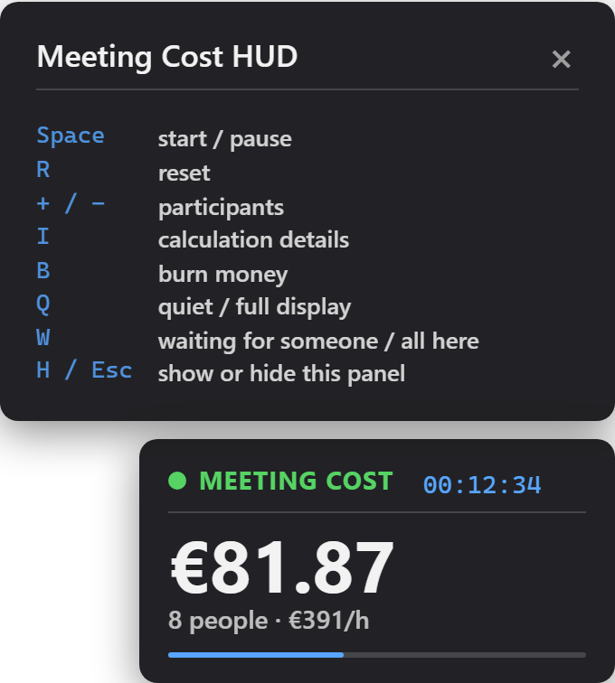

# Meeting Cost HUD

    

Live meeting cost overlay for OBS Studio and any video call app (Microsoft Teams, Zoom, Google Meet, …), in a single HTML file. Works offline, no dependencies.

**[Try it in your browser](https://yokoac.github.io/meeting-cost-hud/meeting-cost.html)**, or download `meeting-cost.html` and open it locally.

https://github.com/user-attachments/assets/ec491d59-ad0f-43cb-82b9-ab0474f5bd8c

## Usage

Open `meeting-cost.html` in a browser. Settings start hidden: hover the overlay and click ⚙ (or press H). Enter participants, average annual salary, employer cost factor and working hours per year, then press **Start** or click the overlay. **Currency** takes any 3-letter ISO code (EUR, USD, GBP, CHF, JPY, CNY, …); an unknown code is marked red and ignored. Settings are saved automatically and used next time; **Restore defaults** in the panel sets them back (the timer keeps running).

## Controls

  

| Key | Action |
|---|---|
| `Space` | start / pause the timer |
| `R` | reset time and cost |
| `+` / `-` | one participant more / less (the cost changes from that moment on) |
| `I` | show / hide the calculation details (rate, planned cost, waiting time) |
| `B` | burn money: the full animation with the current cost per hour |
| `Q` | quiet / full display |
| `W` | waiting for someone / all here |
| `H` or `Esc` | show / hide the settings panel |

| Mouse | Action |
|---|---|
| Click the HUD | start / pause |
| Drag the HUD | move it anywhere; dashed outlines show the six snap spots (corners, top/bottom centre) and turn blue when it will snap in |
| Hover the HUD | reveals ⚙ (settings panel) and the corner grip |
| Drag the corner grip | resize (same as **Overlay size**); double-click it to reset |

Click inside the page first so it receives key presses (in OBS: right-click the source → **Interact**). Keys are ignored while you type in a settings field, except `Esc`.

## Features

Burning money: press **Burn** in the panel (or B) to let banknotes fly across the screen and burn up, with the current cost per hour in the centre (e.g. "€272/h going up in flames"). The timer keeps running. A smaller burst plays each time the cost passes a multiple of **Burn every**: leave it empty for auto (about every 10 minutes at the current cost per hour, rounded to 1/2/5 × 10ⁿ, e.g. €50), enter an amount, or 0 to turn it off.

Planned length: a thin bar under the cost fills up over **Planned length (min)** (default 30). The panel shows what that costs at the current rate (≈ €136), **Details** lists it too, and a fresh start announces it once ("30 min planned ≈ €136"; in Quiet display only the minutes). It turns amber at 80%; when the meeting runs over, the bar and the elapsed time turn red and the full burn plays once ("Overtime: €272/h going up in flames"). Short reminders pop up at halfway ("Halfway · 15 min left") and, for meetings over 10 minutes, at "5 min left · time to wrap up". 0 turns all of this off.

Quiet display: press Q (or set **Display** to Quiet) when a running cost would put too much pressure on the meeting. The HUD shrinks to the status dot, the elapsed time and the planned-length bar; the cost keeps counting and appears again when you switch back. Money animations (threshold bursts, the overtime burn) pause; the halfway and 5-min reminders stay, and overtime shows a red label instead of the burn. B still burns on purpose.

Waiting for someone: press W (or **Waiting** in the panel) when you join and the host or a key person isn't there yet. The timer starts if needed and the HUD shows a pulsing blue WAITING; the cost runs as usual. Press W again when everyone is here: the money burned while waiting goes up in flames ("Waited 3:12 · €12.40 burned"; in Quiet display just "Waited 3:12"). **Details** shows the total waiting time and cost.

URL parameters (browser only; OBS's **Local file** ignores them) override saved settings for that visit only, so a bookmark like `?n=20` does not change your saved defaults: `n`, `salary`, `factor`, `hours`, `cur` (ISO code, e.g. EUR, USD, JPY), `pos` (tl, tc, tr, bl, bc, br), `scale` (0.4–4), `burn` (0 = off), `plan` (minutes, 0 = off), `view` (full, quiet), plus flags `overlay` (transparent background), `autostart` and `info` (show calculation details). Example: `meeting-cost.html?n=8&salary=70000&pos=tr&autostart`

## OBS + video calls (Teams, Zoom, Meet, …)

Put the HUD over your webcam in OBS Studio and send it via OBS Virtual Camera to Microsoft Teams, Zoom, Google Meet or any other app that accepts a webcam. Step-by-step guide, a ready-made OBS scene and a test background: [obs/README.md](obs/README.md).

## License

[MIT](LICENSE)
